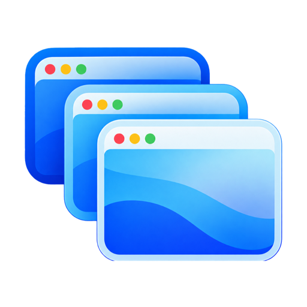
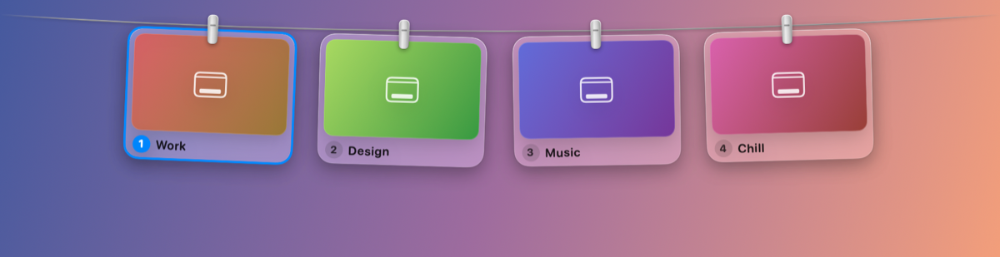
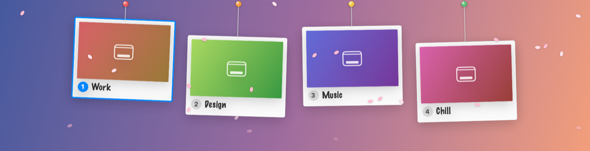
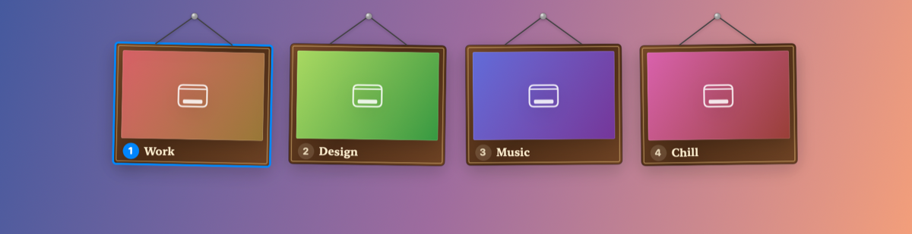
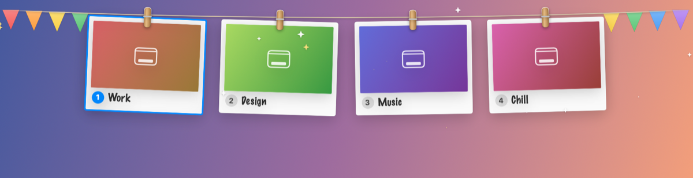
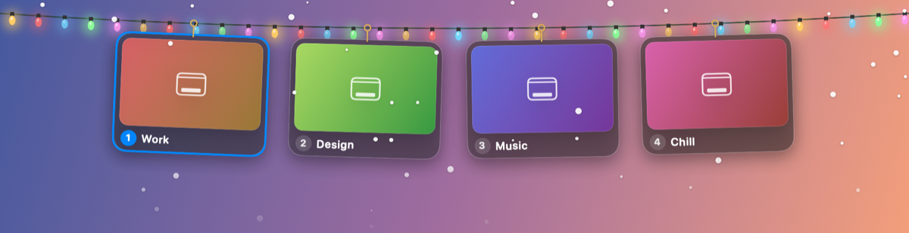
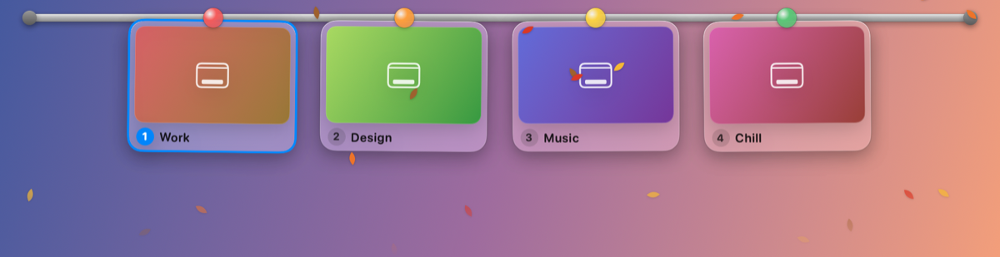

<p align="center"></p>

<h1 align="center">iDesk</h1>

<p align="center"><b>Name your Mac desktops and hang them under the menu bar.</b><br>Every desktop (Space) hangs on a line with a desktop preview and its own name. Click one to go there.</p>

<p align="center">
  <a href="docs/assets/idesk-showreel.mp4"></a>
  <br>
  <sub>▶ <a href="docs/assets/idesk-showreel.mp4">Watch the full 60-second showreel with sound</a></sub>
</p>

iDesk is a menu bar app written in Swift with SwiftUI, AppKit, and ScreenCaptureKit, built from the same Capture Line that iSnap uses for screenshots.

## What's new in v1.2.1

See [release notes](docs/releases/v1.2.1.md) and [CHANGELOG.md](CHANGELOG.md).

The menu bar icon and desktop name follow the native macOS foreground color again, fixing the black foreground introduced in v1.2.0. Custom desktop colors remain inside the menu and other iDesk views. Long names are cut in the menu bar (the tooltip shows the whole name), an unreadable settings file is kept as `settings.json.bak`, a desktop switch that never arrives is reported, and shortcuts accept `-`, `` ` ``, arrows, Tab and Return.

Also included from v1.2.0:

- Find desktops by name or number with **⌃⌥S**, and return to the previous desktop on the pointer's display with **⌃⌥P**.
- Turn **Follow window** off in the window picker to move a window and stay where you are; **⌘← / ⌘→** chooses its destination from the search field.
- Record shortcuts by pressing keys in **Settings → General**; invalid, duplicate and unavailable shortcuts show an error.
- Choose each desktop's color and icon in **Settings → Desktops**, shown on the line, menu, search and name banner.
- Refresh current previews, see capture times, clear saved previews, or keep previews only in memory.
- Use **Coding**, **Meeting** and **Presenting** presets, or save your own in **Settings → Presets**; apply them from Settings or the menu bar.

## Highlights

### Name every desktop

macOS calls them "Desktop 1, 2, 3…" and has no way to rename them. iDesk keeps your names (Work, Design, Music…) keyed by each Space's UUID, so a name follows its desktop even after you reorder desktops in Mission Control. Rename from the line (the pencil on a card, or right-click), from the menu bar, from Settings, or with `⌃⌥R` for the desktop you are on. The menu bar shows the current desktop's name.

### The Desktop Line

Rest the pointer in the menu bar and the line slides down with every desktop on that display, each with a picture of what is on it. Click a card to switch there. Choose **Show on Hover**, **Always Show**, or **Only with Shortcut**, and toggle it any time with `⌃⌥D`. The line steps aside over full screen apps.

### Add and delete desktops

Right-click a card, use the menu bar's **Add Desktop** and **Delete Desktop**, or the buttons in **Settings → Desktops**. Deleting asks first; the desktop's windows move to another one. The desktop you are on, the last desktop on a display, and full screen apps cannot be deleted.

### Move a window to another desktop

Press **⌃⌥M** to open the window picker, or choose **Move a Window…** from the menu bar. Search by application or window title, select a window, choose a destination card, and press **Move and Follow** (Return). Turn **Follow window** off to use **Move** and stay on the current desktop. From the search field, **⌘← / ⌘→** selects the destination. Up/Down in the search field selects a window; Esc or the same shortcut closes the popup. The picker lists regular windows on the currently visible desktops, with app icons and titles, and uses saved desktop previews when available. No Screen Recording permission is needed to list windows. Change or clear the shortcut under **Settings → General → Shortcuts → Open window picker**.

Select the application window, then **Shift-click** the destination's card on the Desktop Line. iDesk moves that window and follows it to the destination, ready to use. You can also use the menu bar's **Move Window to Desktop** submenu or right-click a card and choose **Move Window Here and Follow**.

This requires Accessibility access and works between regular desktops on the same display. Exit full screen or Split View first; windows assigned to all desktops must be unpinned. iDesk keeps the window selected when the menu opens and checks that it reached the destination before switching there. Following uses the existing Mission Control keyboard shortcuts.

### Screens for streaming and presenting

With more than one screen connected, the menu bar's **Screens** submenu and **Settings → Screens** choose which screens are on: **All Screens On**, **Main Screen Only**, **Only <screen>** (one choice per external screen), or each screen on and off by itself. iDesk never changes what a screen shows or its resolution.

Turning a screen off asks you to keep the change and undoes it after 15 seconds without an answer, in case the dialog ended up on a dark screen. `⌃⌥⌘D` turns every screen back on, and so do quitting iDesk and logging out.

With **External Screen Only**, unplugging that screen automatically brings the main screen back on. Reconnecting the same screen restores external-only mode once it is active, even if macOS assigns it a new display ID. iDesk remembers this choice while it is running; choosing another layout or turning every screen back on cancels it.

Before system sleep, iDesk attempts to re-enable screens it turned off and pauses automatic layout changes. On wake, it retries recovery and waits at least three seconds before restoring external-only mode, allowing macOS to update its screen list. If the external screen was unplugged while asleep, the built-in screen stays on. Other layouts with disabled screens return to all available screens on after sleep.

### Six ways to hang

| | |
| --- | --- |
| **Clothesline**: a sagging rope with aluminium clips | **Strings**: pinned threads of different lengths, swinging like pendulums |
|  |  |
| **Picture Frames**: wooden frames on nails | **Bunting**: polaroids on a rope of pennants, held by wooden pegs |
|  |  |
| **Fairy Lights**: twinkling bulbs with brass hooks | **Magnetic Rail**: a steel rail with coloured magnets |
|  |  |

### Effects

- **Sway**: Still, Gentle Breeze, or Windy (constant sway with gusts)
- **Switch effect** on the desktop you arrive on: Swing, Bounce, Spin, Glow, or None
- **Particles** drifting from the line: Snow, Sparkles, Cherry Petals, or Autumn Leaves
- **Name banner** after each switch: a Hanging Sign that drops and swings on its strings, or a Glass Pill
- Cards drop in and swing when the line comes down, and lean over when hovered

Visual choices and language are grouped under **Appearance** in the menu bar. Rename, add, delete, and direct window moves are under **Desktop Actions**; the window picker and Show/Hide the Line stay at the top level. **Settings → Look** has a live preview.

To reduce background power use, pointer tracking reacts to mouse events, and wind timers run only while a windy Desktop Line is revealed. The Settings animation pauses when its window is hidden or covered; idle animation also pauses when screens sleep or Reduce Motion is enabled. Low Power Mode lowers idle animation from 30 to 15 frames per second.

### And more

- Full screen apps can hang on the line too (off by default)
- Multiple displays, with or without "Displays have separate Spaces"
- English and Tiếng Việt interface, launch at login, optional switch sound

## How it works, and its limits

macOS has no public API for Spaces, so iDesk works the way other Spaces utilities do:

- **Reading desktops** uses the window server's private `CGSCopyManagedDisplaySpaces` call, the same call iSnap uses to detect full screen apps. It needs no permission.
- **Names live in iDesk.** They appear in iDesk's line, menu, and banner. Mission Control and the system itself still show "Desktop 1, 2, 3…"; no app can change that.
- **Switching** presses the Mission Control shortcuts for you, which needs **Accessibility** access. If "Switch to Desktop N" is enabled in System Settings → Keyboard → Keyboard Shortcuts → Mission Control, iDesk jumps straight there; otherwise it walks with ⌃← / ⌃→ (on by default). iDesk reads your actual shortcuts from `com.apple.symbolichotkeys`.
- **Previews** need **Screen Recording** access (optional). macOS cannot show a desktop you are not on, so each picture is taken at startup, after arriving on that desktop, and when opening the Desktop Line. Repeated requests within five seconds reuse the saved picture; idle desktops are not captured periodically. Visit each desktop once after installing. Without the permission, the wallpaper stands in. iDesk's own windows are left out of the pictures, and the pictures stay on your Mac in `~/Library/Caches/dev.idesk.app`. In **Settings → General → Preview Storage**, turn off **Save previews on disk** to remove saved images and keep future previews in RAM only. **Settings → Desktops** shows capture times and offers **Refresh Current Previews** and **Clear Preview Cache**. Refresh only captures desktops currently visible on connected screens.

- **Adding and deleting desktops** uses Mission Control's own buttons through Accessibility (the approach of Hammerspoon's `hs.spaces`): iDesk opens Mission Control for a moment, presses the button, and closes it. If Mission Control does not show its buttons to iDesk, iDesk says so and offers to open Mission Control so you can do it by hand.
- **Moving a window** reads the focused window through Accessibility and uses private SkyLight calls, including the compatibility-workspace route on macOS 14.5 and later described by [Hammerspoon](https://github.com/Hammerspoon/hammerspoon/blob/master/extensions/spaces/libspaces.m). Symbols are loaded at runtime and the window's Space membership is checked afterward; unsupported systems show an error.
- **Turning a screen off** uses the window server's private `CGSConfigureDisplayEnabled`, as display utilities do; every change lasts for the login session only.

## Requirements

- macOS 14 Sonoma or later
- Accessibility access to switch desktops; Screen Recording access for previews (optional)
- To build: Xcode 16 or later and [XcodeGen](https://github.com/yonaskolb/XcodeGen)

## Download and install

Download the `.dmg` (or the `.zip`) from the [latest release](https://github.com/Vhaooforjob/idesk/releases/latest).

**Requirements:** macOS 14 Sonoma or later, Apple Silicon or Intel.

1. Open the `.dmg` and drag **iDesk** into **Applications** (with the `.zip`, unzip it and move `iDesk.app` to Applications).
2. Open **iDesk** from Applications. The first time, macOS says it cannot verify the app, because it is not notarized by Apple. This is expected for an independent release. Choose one of:
   - **System Settings → Privacy & Security**, scroll to *"iDesk" was blocked*, click **Open Anyway**, then confirm. (On macOS 14, right-click the app and choose **Open** instead.)
   - Or run once in Terminal: `xattr -dr com.apple.quarantine /Applications/iDesk.app`
3. Grant permissions: iDesk lives in the menu bar. Grant **Accessibility** under **System Settings → Privacy & Security → Accessibility** to switch desktops, and (optionally) **Screen Recording** for desktop previews, then restart iDesk. Visit each desktop once so its preview can be captured.

Always run iDesk from **Applications** so macOS keeps your permissions. After an update you may have to toggle the permission off and on again, because this build is signed ad hoc. If you want to build from source instead, see below.

## Build from source

```bash
swift build
swift test
```

Build the app with Xcode:

```bash
xcodegen generate
xcodebuild -project iDesk.xcodeproj -scheme iDesk -configuration Release build
```

Copy the built `iDesk.app` to `/Applications` and open it; it lives in the menu bar. Set your Apple Development team in `project.yml` (`DEVELOPMENT_TEAM`) and always run the copy in Applications, so macOS keeps the Accessibility and Screen Recording permissions between builds.

The logo is `docs/assets/logo-source.png`. `scripts/make-icon.sh [logo.png]` cleans it up, fits it to the macOS icon grid, fills `Assets.xcassets` with every app icon size and writes `docs/assets/idesk-logo.png` for the docs.

Images of every hanging style are rendered from the real views:

```bash
IDESK_SHOTS_DIR=/tmp/idesk-shots swift test --filter StyleShotsTests
```

## Architecture

iDesk follows MVVM. Views only draw view model state and send intents back; view models hold the app's logic and never touch AppKit windows or alerts; services wrap the system.

```text
Sources/iDesk
├── App          iDeskApp (entry point, AppDelegate), AppEnvironment (builds services and view models)
├── Models       DesktopSpace + SpaceLayout, AppSettings, HangingDesktop + LineLook,
│                DisplayArrangement + DisplayLayout, AppLanguage
├── ViewModels   DesktopsViewModel     desktops, names, previews, switching, renaming (shared)
│                DesktopLineViewModel  what hangs on the line, its look, reveal state, effects
│                NameBannerViewModel   the name shown after a switch
│                MenuBarViewModel      menu bar title, desktop list and option groups
│                DisplaysViewModel     which screens are on, confirm-or-undo
│                SettingsViewModel     everything the Settings window edits
│                DialogPresenting      the questions view models ask the user
├── Services     SpaceService, SpaceSwitcher, WindowMoveService, MissionControlService, DisplayService,
│                ThumbnailStore, PermissionService, HotkeyService,
│                SettingsStore, LaunchAtLoginService, AppRelauncher
└── Views
    ├── Line       DesktopLineView, LineDecor, LineLayout, DesktopLineWindowController
    ├── Banner     NameBannerView, NameBannerWindowController
    ├── MenuBar    MenuBarController
    ├── Settings   SettingsView, SettingsWindowController
    └── Dialogs    AlertDialogs
```

`DesktopsViewModel` is the hub: it publishes `arrivals` (a desktop was switched to) and `highlights` (a card should play its effect), and every other view model builds on it. Services and dialogs are passed in, so the view models are tested with fixed Spaces and scripted answers (`Tests/iDeskTests/ViewModelTests.swift`).

## License

iDesk is released under the [MIT License](LICENSE).

The Desktop Line's rope, clips, swing and hover reveal are adapted from [Tendedero](https://github.com/alejandrobujan/tendedero) (MIT) by way of iSnap; its license notice is kept at the top of `Sources/iDesk/Views/Line/DesktopLineView.swift`.
